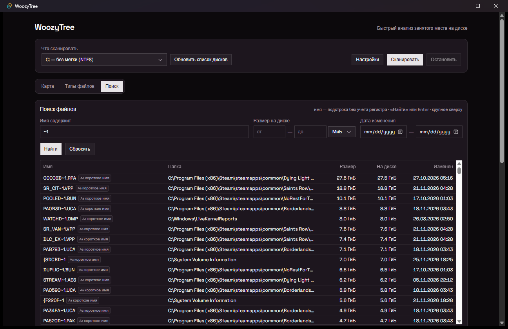

# WoozyTree

Быстрый анализатор занятого места на диске для Windows — клон WizTree с тёмной
темой. Читает таблицу MFT напрямую и показывает, чем занят диск: интерактивную
карту занятости (она растёт вживую прямо во время сканирования), дерево папок,
таблицу файлов, типы файлов, поиск и топ крупнейших папок.

Стек: Rust + Tauri 2 + React + TypeScript + Vite + Tailwind CSS 4 + shadcn/ui.


Карта работает как зум: клик по папке или её ярлыку открывает вложенную карту,
«Вверх» и хлебные крошки возвращают на нужный уровень. Во время сканирования
карта и топ обновляются примерно раз в секунду, а дерево и таблица становятся
доступны после его завершения.



## Возможности (паритет с WizTree)

- **Сканирование**: один диск, «Все диски» (каждый том — подпапка общего корня)
  или отдельная папка; повторный запуск и остановка на полпути.
- **Карта занятости**: подсказки с именем, размером и долей, клик-зум внутрь
  папки, возврат по крошкам/«Вверх»/Alt+↑. У крупных папок ярлык с именем и
  собственным размером; мелочь собирается в плитку «прочее».
- **Дерево папок + таблица файлов**: имя, размер, размер на диске, % от
  родителя, дата изменения; в дереве — число файлов и папок. Сортировка по
  имени, размерам и дате, догрузка страниц при прокрутке.
- **Типы файлов**: рекурсивная группировка по расширениям, treemap по типам и
  таблица с долями; сортировка по имени, числу файлов и обоим размерам.
- **Поиск**: по подстроке имени (без учёта регистра, «ё» ≈ «е»), диапазону
  размера на диске и дате изменения; пагинация, переход к папке файла на карте.
- **Действия с файлами**: открыть, показать в Проводнике, скопировать путь,
  удалить в корзину или безвозвратно — последнее только через диалог
  подтверждения и только для обычных файлов.
- **Настройки отображения**: «на диске» или «фактический» размер, показывать ли
  файлы на карте, порог «не показывать мельче N МиБ». Настройки сохраняются в
  `localStorage` и применяются сразу; живая карта скана использует снимок
  настроек на момент старта.
- **Жёсткие ссылки честно**: размер файла учитывается один раз; повторные
  ссылки видны в таблице и поиске с пометкой «жёсткая ссылка»: в таблице их
  доля 0.0 %, в поиске — пометка.
  Короткие DOS-имена (8.3) помечены отдельно — «короткое имя»; безвозвратное
  удаление по ним, как и по вторичным ссылкам, запрещено, чтобы не потерять
  единственный файл.
- **Живое сканирование**: прогресс, растущая карта и топ папок; статусы
  «Остановлено» (частичные данные) и «Ошибка».

## Как это работает

В NTFS у каждого файла и папки есть запись в служебной таблице — **MFT**
(Master File Table, «главная файловая таблица»). Это по сути каталог всего тома:
имя, родительская папка, размеры, время изменения. Windows при обычном обходе
читает папки по одной и на миллионах файлов тратит минуты. WoozyTree открывает
том как файл, последовательно читает MFT и разбирает записи сам — поэтому один
проход по таблице даёт сразу всё дерево.

На диске C: около **1,2 млн файлов** сканируются примерно за **6 секунд**;
итог расходится с «Занято» в Windows примерно на **0,43 %**.

## Сборка

Нужны:

- Windows 10/11 (x64);
- Rust (stable, toolchain `x86_64-pc-windows-msvc`);
- MSVC Build Tools с компонентом «Desktop development with C++»;
- Node.js (LTS) и npm;
- WebView2 — в современных Windows уже установлен.

```powershell
npm install
npm run tauri dev
```

Приложение запускается с правами администратора: без них Windows не даёт открыть
сырой том и прочитать MFT. Запрос UAC при старте — это нормально.

## Тесты

```powershell
cargo test --manifest-path src-tauri/Cargo.toml --lib
npx vitest run
```

Флаг `--lib` гоняет только юнит-тесты библиотеки. У bin-целей тестов нет, а
тестовый харнесс главного бина унаследовал бы манифест `requireAdministrator` и
без прав падал с `os error 740` — поэтому у него стоит `test = false`.

`npx vitest run` прогоняет тесты интерфейса: чистые функции форматирования,
прогресса, дерева папок, карты (хит-тест, вложенность, крошки), настроек,
поиска, типов файлов и навигации.

Тестовые фикстуры MFT генерируются синтетически и автоматически при первом
обращении: реальные слепки диска в репозитории не хранятся (каталог
`src-tauri/tests/fixtures/` в `.gitignore`). Свежий клон проходит тесты без
дополнительных шагов, а генератор детерминирован — повторный запуск даёт те же
байты и те же результаты.

## Утилиты

`dump_mft` и большинство режимов `scan_bench` запускаются от администратора;
`scan_bench --fixture` и синтетические замеры (`--files`, `--diag`) работают без
прав.

### dump_mft

Снимает сырые записи MFT с живого тома для локального анализа или отладки:

```powershell
cargo run --manifest-path src-tauri/Cargo.toml --bin dump_mft -- C: C:\Temp\mft\sample.mft --records 2000 --boot --corrupt
```

- `--records N` — записать только первые N записей;
- `--boot` — сохранить загрузочный сектор в `boot.bin` рядом с файлом;
- `--corrupt` — испортить последнюю запись (проверка устойчивости парсера).

Такие слепки содержат настоящие имена файлов: снимайте их вне рабочей копии
(например, в `C:\Temp`) и не коммитьте. Каталог `src-tauri/tests/fixtures/`
исключён из git как удобное место для синтетических файлов, которые тесты
создают сами, а не как безопасное хранилище реальных данных.

### scan_bench

Замеряет скорость сканирования и печатает итоги, топ папок и разбивку пропусков
по причинам. Режимы:

- `scan_bench C:` — обычный замер: итоги, топ папок, время по фазам, пропуски;
- `scan_bench --live C:` — тот же путь, что в приложении: `run_scan` с живыми
  событиями топа и карты раз в секунду, замер пауз между ними;
- `scan_bench --files 100000` — синтетическая папка на 100 000 файлов: цена
  страницы таблицы и сортировок по каждой колонке;
- `scan_bench --treemap C: 2000` — раскладка карты на готовом индексе с бюджетом
  2 000 прямоугольников (проверка покрытия площади и числа плиток);
- `scan_bench --fixture C:\Temp\mft\sample.mft` — скан слепка MFT без тома и без
  прав администратора;
- `scan_bench --diag C:\Temp\mft\sample.mft` — сколько имён разобрано из каждой
  записи слепка (сверка с независимым разбором).

```powershell
cargo run --manifest-path src-tauri/Cargo.toml --bin scan_bench -- C:
```

Для проверки на слепке:

```powershell
cargo run --manifest-path src-tauri/Cargo.toml --bin scan_bench -- --fixture C:\Temp\mft\sample.mft
```

## Границы точности

Честно о том, где итог может отличаться от Проводника и «Занято» в Windows:

- Размер папки складывается из файлов; сами каталоги (их записи в MFT и
  индексные буферы) в сумму не входят.
- `$ATTRIBUTE_LIST` не разбирается: имена из extension-записей теряются
  (счётчик `extension_with_names`), но размеры `$DATA` движок подставляет из
  extension-записей по ссылке `base_record`. Потерянные имена попадают в
  «пропущено»; разбивку по причинам печатает `scan_bench`.
- Жёсткая ссылка учитывается один раз — в той папке, где встретилась первой.
  Остальные её имена видны в таблице и поиске, но в итоги не входят: в таблице
  их доля 0.0 %, в поиске — пометка.
- Поэтому итоговый размер может отличаться от «Занято» в Windows на доли
  процента — это ожидаемо, а не ошибка чтения диска.

## Известные ограничения

- **Экспорт CSV не реализован**: он был отменён по решению пользователя, поэтому
  ни в интерфейсе, ни в README его нет как готовой функции.
- `$ATTRIBUTE_LIST` не разбирается (подробнее — «Границы точности»).
- Короткие DOS-имена (8.3) видны в таблице и поиске отдельными строками с
  подписью «короткое имя»; отдельными папками в дереве они не показываются.
- Живая карта строится по снимку настроек на старте скана: изменения настроек
  во время скана применятся к карте после его завершения (и к новому скану).
- treemap рисует до 2 000 плиток (карта типов — до 600), а таблица типов
  агрегирует всё поддерево целиком; «прочее» — это отображение, итоги не
  меняются.

## Структура проекта

```text
src-tauri/src/          ядро сканирования (Rust)
  lib.rs                команды Tauri, состояние приложения и снимок настроек скана
  model.rs              DTO для интерфейса: папки, файлы, типы, прямоугольники карты
  scan/volume.rs        загрузочный сектор и сырое чтение $MFT
  scan/mft.rs           разбор записей MFT и построение дерева (алиасы 8.3, ADS)
  scan/walk.rs          запасной обход папок (не-NTFS, сетевые диски, папка)
  scan/index.rs         индекс в памяти: итоги, страницы, поиск, типы, карта типов
  scan/mod.rs           выбор движка, живая карта/топ и сервис сканирования
  treemap/layout.rs     squarified-раскладка: вложенные прямоугольники, «прочее»
  files/ops.rs          корзина, безвозвратное удаление, открытие, Проводник
  bin/dump_mft.rs       утилита снятия слепков MFT
  bin/scan_bench.rs     замеры скорости, живой режим, карта, таблица
src/                    интерфейс (React + TypeScript)
  App.tsx               состояние приложения, путь, подписки на события
  components/Toolbar.tsx        выбор охвата, старт/остановка, настройки
  components/Treemap.tsx        canvas-карта: живой поток, зум, подсказки, действия
  components/FolderTree.tsx     ленивое дерево папок
  components/FileTable.tsx      таблица файлов: сортировка, догрузка, действия
  components/FileTypesPanel.tsx вкладка «Типы файлов»: карта и таблица
  components/SearchPanel.tsx    вкладка «Поиск»: фильтры и виртуальная выдача
  components/TopFolders.tsx     топ-20 папок по выбранному размеру
  components/ScanStatus.tsx     крошки, прогресс, итоги и статусы
  components/SettingsPopover.tsx настройки отображения
  components/FileActionsMenu.tsx меню действий и диалог удаления
  lib/types.ts          TS-зеркало DTO из Rust
  lib/ipc.ts            команды и события Tauri
  lib/format.ts         размеры, проценты, даты и склонения
  lib/progress.ts       процент заполненности диска
  lib/files.ts          чистые функции ленивого дерева папок
  lib/treemap.ts        хит-тест, вложенность и крошки карты
  lib/settings.ts       настройки, порог мелочи, `size_for`
  lib/search.ts         разбор фильтров поиска
  lib/filetypes.ts      сортировка и подписи вкладки типов
  lib/actions.ts        склонения, причина запрета удаления, буфер обмена
  lib/navigation.ts     замена/усечение пути и «Вверх»
  lib/query.ts          область placeholder-данных кэша
  lib/top.ts            топ папок по выбранному режиму размера
docs/                   скриншоты и материалы разработки
```

## Roadmap

Планы 1–3 закрыты: чтение MFT, живая карта/дерево/таблица, поиск, типы файлов,
действия с файлами и настройки. Дальше — свободное развитие: оптимизации из
списка Плана 2, установщик, мультиязычность. Экспорт CSV в планы не входит.
