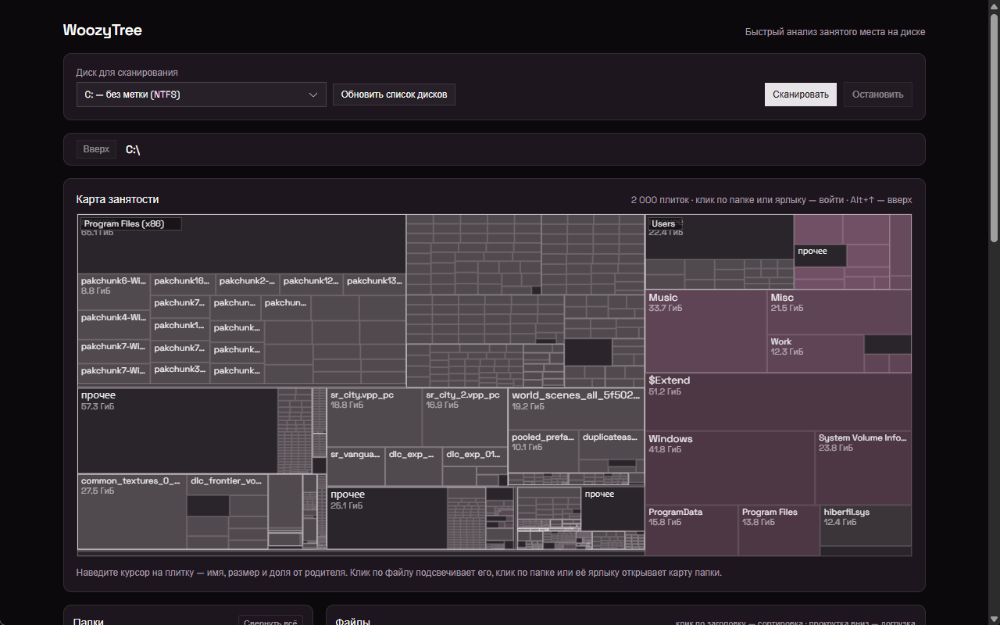

# WoozyTree

Быстрый анализатор занятого места на диске для Windows — клон WizTree с тёмной
темой. Читает таблицу MFT напрямую и показывает, чем занят диск: интерактивную
карту занятости (она растёт вживую прямо во время сканирования), дерево папок,
таблицу файлов и топ крупнейших папок.

Стек: Rust + Tauri 2 + React + TypeScript + Vite + Tailwind CSS 4 + shadcn/ui.



Карта работает как зум: клик по папке или её ярлыку открывает вложенную карту,
«Вверх» и хлебные крошки возвращают на нужный уровень. Во время сканирования
карта и топ обновляются примерно раз в секунду, а дерево и таблица становятся
доступны после его завершения.

## Как это работает

В NTFS у каждого файла и папки есть запись в служебной таблице — **MFT**
(Master File Table, «главная файловая таблица»). Это по сути каталог всего тома:
имя, родительская папка, размеры, время изменения. Windows при обычном обходе
читает папки по одной и на миллионах файлов тратит минуты. WoozyTree открывает
том как файл, последовательно читает MFT и разбирает записи сам — поэтому один
проход по таблице даёт сразу всё дерево.

На диске C: около **1,2 млн файлов** сканируются примерно за **6 секунд**;
итог расходится с «Занято» в Windows примерно на **0,43 %**.

## Сборка

Нужны:

- Windows 10/11 (x64);
- Rust (stable, toolchain `x86_64-pc-windows-msvc`);
- MSVC Build Tools с компонентом «Desktop development with C++»;
- Node.js (LTS) и npm;
- WebView2 — в современных Windows уже установлен.

```powershell
npm install
npm run tauri dev
```

Приложение запускается с правами администратора: без них Windows не даёт открыть
сырой том и прочитать MFT. Запрос UAC при старте — это нормально.

## Тесты

```powershell
cargo test --manifest-path src-tauri/Cargo.toml --lib
npx vitest run
```

Флаг `--lib` гоняет только юнит-тесты библиотеки. У bin-целей тестов нет, а
тестовый харнесс главного бина унаследовал бы манифест `requireAdministrator` и
без прав падал с `os error 740` — поэтому у него стоит `test = false`.

`npx vitest run` прогоняет тесты интерфейса: чистые функции форматирования,
прогресса, дерева папок и карты (хит-тест, вложенность, крошки).

Тестовые фикстуры MFT генерируются синтетически и автоматически при первом
обращении: реальные слепки диска в репозитории не хранятся (каталог
`src-tauri/tests/fixtures/` в `.gitignore`). Свежий клон проходит тесты без
дополнительных шагов, а генератор детерминирован — повторный запуск даёт те же
байты и те же результаты.

## Утилиты

`dump_mft` и большинство режимов `scan_bench` запускаются от администратора;
`scan_bench --fixture` и синтетические замеры (`--files`, `--diag`) работают без
прав.

### dump_mft

Снимает сырые записи MFT с живого тома для локального анализа или отладки:

```powershell
cargo run --manifest-path src-tauri/Cargo.toml --bin dump_mft -- C: C:\Temp\mft\sample.mft --records 2000 --boot --corrupt
```

- `--records N` — записать только первые N записей;
- `--boot` — сохранить загрузочный сектор в `boot.bin` рядом с файлом;
- `--corrupt` — испортить последнюю запись (проверка устойчивости парсера).

Такие слепки содержат настоящие имена файлов: снимайте их вне рабочей копии
(например, в `C:\Temp`) и не коммитьте. Каталог `src-tauri/tests/fixtures/`
исключён из git как удобное место для синтетических файлов, которые тесты
создают сами, а не как безопасное хранилище реальных данных.

### scan_bench

Замеряет скорость сканирования и печатает итоги, топ папок и разбивку пропусков
по причинам. Режимы:

- `scan_bench C:` — обычный замер: итоги, топ папок, время по фазам, пропуски;
- `scan_bench --live C:` — тот же путь, что в приложении: `run_scan` с живыми
  событиями топа и карты раз в секунду, замер пауз между ними;
- `scan_bench --files 100000` — синтетическая папка на 100 000 файлов: цена
  страницы таблицы и сортировок по каждой колонке;
- `scan_bench --treemap C: 2000` — раскладка карты на готовом индексе с бюджетом
  2 000 прямоугольников (проверка покрытия площади и числа плиток);
- `scan_bench --fixture C:\Temp\mft\sample.mft` — скан слепка MFT без тома и без
  прав администратора;
- `scan_bench --diag C:\Temp\mft\sample.mft` — сколько имён разобрано из каждой
  записи слепка (сверка с независимым разбором).

```powershell
cargo run --manifest-path src-tauri/Cargo.toml --bin scan_bench -- C:
```

Для проверки на слепке:

```powershell
cargo run --manifest-path src-tauri/Cargo.toml --bin scan_bench -- --fixture C:\Temp\mft\sample.mft
```

## Границы точности

Честно о том, где итог может отличаться от Проводника и «Занято» в Windows:

- Размер папки складывается из файлов; сами каталоги (их записи в MFT и
  индексные буферы) в сумму не входят.
- `$ATTRIBUTE_LIST` не разбирается: имена из extension-записей теряются
  (счётчик `extension_with_names`), но размеры `$DATA` движок подставляет из
  extension-записей по ссылке `base_record`. Потерянные имена попадают в
  «пропущено»; разбивку по причинам печатает `scan_bench`.
- Поэтому итоговый размер может отличаться от «Занято» в Windows на доли
  процента — это ожидаемо, а не ошибка чтения диска.

## Известное ограничение

Живая карта занятости, топ папок, дерево и таблица файлов уже работают: карта
растёт во время сканирования, а после него панели показывают текущую папку.
Чего в этой версии ещё нет:

- поиска, фильтров и отбора по типам файлов;
- действий с файлами (открыть, показать в Проводнике, удалить);
- экспорта в CSV и настроек.

Это следующий план (План 3).

Ограничения данных:

- `$ATTRIBUTE_LIST` не разбирается: имена из extension-записей теряются, поэтому
  часть имён отсутствует в индексе (подробнее — «Границы точности»);
- повторная жёсткая ссылка, чья первая копия лежит в другой папке, показывается
  со 100 % от размера родителя — планируется 0 %, чтобы доля отражала реальный
  вклад в занятое место.

## Структура проекта

```text
src-tauri/src/          ядро сканирования (Rust)
  lib.rs                команды Tauri и состояние приложения
  model.rs              DTO для интерфейса: папки, файлы, прямоугольники карты
  scan/volume.rs        загрузочный сектор и сырое чтение $MFT
  scan/mft.rs           разбор записей MFT и построение дерева
  scan/walk.rs          запасной обход папок (не-NTFS, сетевые диски, папка)
  scan/index.rs         индекс в памяти и агрегированные итоги
  scan/mod.rs           выбор движка и сервис сканирования с живыми событиями
  treemap/layout.rs     раскладка карты: вложенные прямоугольники и бюджет
  treemap/mod.rs        модуль карты
  bin/dump_mft.rs       утилита снятия слепков MFT
  bin/scan_bench.rs     замеры скорости, живой режим, карта, таблица
src/                    интерфейс (React + TypeScript)
  App.tsx               состояние приложения, путь навигации, подписки на события
  components/Toolbar.tsx      выбор диска, старт и остановка сканирования
  components/ScanStatus.tsx   хлебные крошки, прогресс и итоги
  components/Treemap.tsx      canvas-карта: живой поток, зум, подсказки
  components/FolderTree.tsx   ленивое дерево папок
  components/FileTable.tsx    таблица файлов: сортировка и догрузка страниц
  components/TopFolders.tsx   топ крупнейших папок
  components/ui/              элементы shadcn/ui
  lib/types.ts          TS-зеркало DTO из Rust
  lib/ipc.ts            команды и события Tauri
  lib/format.ts         размеры, числа и даты
  lib/progress.ts       процент заполненности диска
  lib/files.ts          чистые функции ленивого дерева папок
  lib/treemap.ts        хит-тест, вложенность и крошки карты
docs/                   скриншот и материалы разработки
```
